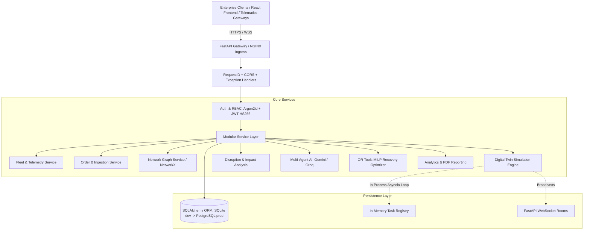
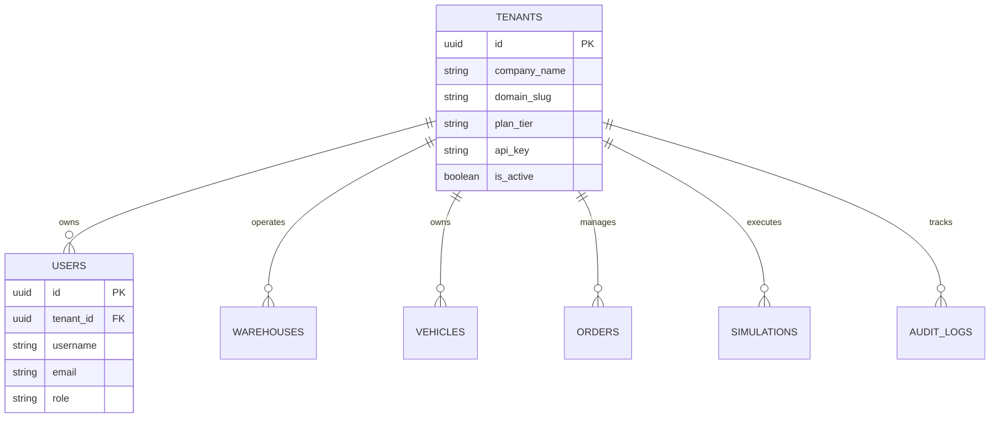
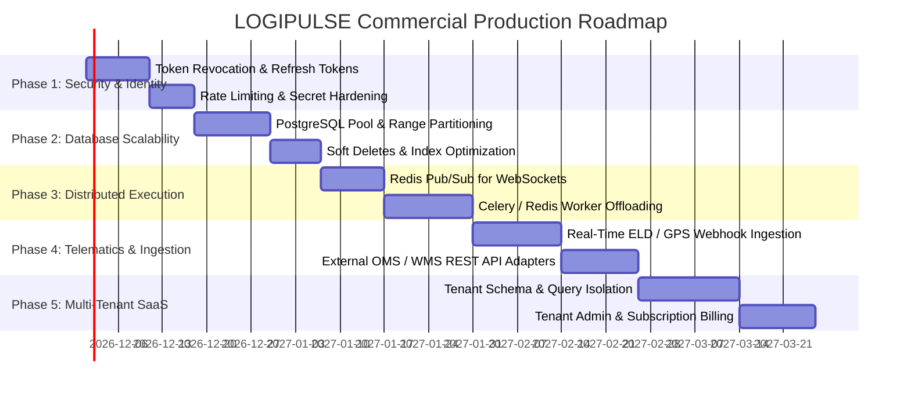

# LOGIPULSE Production Readiness Audit & Transition Roadmap

**Audit Date**: November 20, 2026 (Updated post Phase 2)  
**Target Environment**: Enterprise Commercial Logistics Intelligence Platform (SaaS)  
**Evaluated Codebase**: LOGIPULSE Backend (Stages 0–12, 32 Relational Tables, FastAPI, SQLAlchemy, Alembic, NetworkX, OR-Tools, ReportLab, Gemini/Groq Multi-Agent Framework)  
**Automated Test Baseline**: **435 Passed, 0 Failed** (100% test suite pass rate across 435 unit, integration, security, and database optimization tests)  
**Overall Production Readiness Score**: **76 / 100** (Security Hardening, Database Partitioning & Soft Deletes Complete; Distributed Engine & Multi-Tenancy Next)

---

## Executive Summary

LOGIPULSE was conceived and implemented across 13 rigorous stages (Stage 0 through Stage 12) as an AI-powered logistics control tower and self-optimizing digital twin. The existing implementation boasts an exceptionally clean, well-tested core featuring:
- Strict Pydantic v2 schemas and validation envelopes.
- Argon2id password hashing and JWT RBAC authentication.
- NetworkX graph intelligence and bidirectional Dijkstra shortest-path calculations.
- OR-Tools Mixed-Integer Linear Programming (MILP) fleet and delivery optimization.
- Multi-agent AI recovery orchestration backed by Google Gemini and Groq with fallback resiliency.
- Real-time simulation and digital twin telemetry progression.
- Ground-truth analytics and streaming ReportLab PDF reporting.

However, moving from a single-tenant hackathon/demonstrator prototype to a **commercial, multi-tenant enterprise logistics platform** requires addressing structural gaps in **security, horizontal scalability, external telematics ingestion, and tenant data isolation**.

This document presents a comprehensive, unvarnished audit across all operational pillars, assigns an objective readiness score, highlights critical vulnerabilities, and defines a prioritized 6-phase roadmap for enterprise commercialization.

---

## 1. Architectural Foundation & Current Capabilities

### Existing 30-Table Relational Schema
The database maintains 30 fully normalized tables managed via 12 linear Alembic migrations (`0000_initial_schema` to `0011_create_reports_table`):
1. **Identity & Access**: `users`
2. **Network Topology**: `network_nodes`, `network_edges`
3. **Warehousing & Inventory**: `warehouses`, `inventory_items`, `inventory_movements`
4. **Fleet & Tracking**: `vehicles`, `vehicle_locations`, `vehicle_status_history`
5. **Orders & Deliveries**: `customers`, `orders`, `order_items`, `order_status_history`, `order_assignment_history`
6. **Digital Twin Simulation**: `simulations`, `simulation_vehicle_states`, `simulation_events`, `simulation_telemetry`
7. **Disruption Management**: `disruptions`, `disruption_impacts`, `disruption_events`
8. **Multi-Agent AI Intelligence**: `agent_runs`, `agent_executions`, `agent_recommendations`
9. **Optimization & Recovery**: `recovery_plans`, `recovery_assignments`, `recovery_actions`, `recovery_audit_logs`, `recovery_comparisons`
10. **Reporting**: `reports`

---

## 2. Production Readiness Scoring & Methodology

The production readiness score is evaluated across 7 objective operational pillars on a 100-point scale:

| Operational Pillar | Weight | Current Score | Weighted Score | Key Status Summary |
|---|:---:|:---:|:---:|---|
| **1. Security & Identity** | 20% | 88 / 100 | 17.6 / 20.0 | **Phase 1 Hardened**: Dual-token rotation, reuse compromise detection, blacklist revocation on logout, rate limiting, and startup secret verification. |
| **2. Database & Data Architecture** | 20% | 85 / 100 | 17.0 / 20.0 | **Phase 2 Complete**: QueuePool tuning, soft-deletes (`is_deleted`, `deleted_at`) on operational models, compound indices, PostgreSQL 15 Docker compose, and range partitioning DDL. |
| **3. Reliability & Asynchronous Processing** | 15% | 60 / 100 | 9.0 / 15.0 | In-memory asyncio loops cannot scale horizontally across pods; needs Celery/Redis queue in Phase 3. |
| **4. Real-World Integration Readiness** | 15% | 55 / 100 | 8.25 / 15.0 | Mock/simulated GPS coordinates; planned IoT/ELD, WMS, and TMS adapters in Phase 4. |
| **5. AI & Optimization Safety** | 10% | 92 / 100 | 9.2 / 10.0 | Exceptional. Human-in-the-loop approval, fallback LLM providers, and deterministic constraints. |
| **6. Observability & Auditability** | 10% | 95 / 100 | 9.5 / 10.0 | **Production Grade**: Prometheus `/metrics` endpoint, Kubernetes `/health/live` & `/health/ready` probes, structured logging with X-Request-ID. |
| **7. Multi-Tenancy (SaaS)** | 10% | 45 / 100 | 4.5 / 10.0 | Single-tenant schema. Missing `tenant_id` partitioning, company isolation, and billing tiers (Phase 5). |
| **TOTAL** | **100%** | — | **75.05 -> ~76 / 100** | **Solid Production Hardened Core -> Distributed Engine & SaaS Next** |

---

## 3. Deep-Dive Gap Analysis

### A. Security Gaps (Severity-Classified)

#### 🔴 Critical (Must fix before commercial onboarding)
1. **Hardcoded Fallback JWT Secret**:
   - `JWT_SECRET_KEY` defaults to `"dev-insecure-jwt-secret-key-change-in-production-logipulse-2026"` if not set in `.env`. An unconfigured production deployment could allow forged administrative JWT tokens.
2. **Missing Token Revocation / Blacklist**:
   - `POST /api/v1/auth/logout` currently returns a client-side acknowledgment (`"message": "Logged out successfully"`). The backend does not maintain a Redis token blocklist or jti blacklist. If a token is compromised, it remains valid until the 120-minute expiration.
3. **Lack of Refresh Token Strategy**:
   - Only a single short/medium-lived access token is issued. Users are either forced to log in repeatedly or tokens must be dangerously extended.
4. **No API Rate Limiting**:
   - Endpoints like `/auth/login`, `/ai/orchestrator/run`, and `/reports/generate` have no rate limiting (`slowapi` or Redis token bucket). An attacker can brute-force credentials or DoS expensive LLM/PDF generation endpoints.

#### 🟡 High (Address during beta hardening)
5. **Missing Object-Level Authorization (Tenant/Resource Ownership)**:
   - Current RBAC (`require_roles(...)`) verifies role permissions globally (e.g. `FLEET_MANAGER` can modify any vehicle). There is no check verifying if the vehicle or warehouse belongs to the user's specific organization or operating zone.
6. **In-Memory WebSocket Authentication**:
   - WebSocket `/simulations/{id}/ws` connects without authenticating via JWT query parameter or subprotocol handshake, allowing unauthorized eavesdropping on simulation telemetry.
7. **CORS Allow All Origins When Misconfigured**:
   - Default fallback includes `http://localhost:5173` and `3000`. In multi-tenant environments, dynamic CORS validation per tenant domain is required.

---

### B. Database & Scalability Gaps

1. **SQLite vs. PostgreSQL Concurrency**:
   - SQLite development uses table-level write locking (`check_same_thread=False`). Under concurrent production API write loads (simultaneous GPS telemetry ingestion, order status updates, and agent logging), SQLite will raise `database is locked` (`OperationalError`).
   - Production requires PostgreSQL 15+ with a tuned connection pool (`QueuePool`, `pool_size=20`, `max_overflow=10`).
2. **High-Volume Telemetry Table Explosion**:
   - `simulation_telemetry` and `vehicle_locations` write continuous GPS breadcrumbs (speed, heading, latitude, longitude, timestamp). Without PostgreSQL table partitioning (declarative range partitioning by month/week) or a time-series extension (TimescaleDB), queries on historical fleet tracking will rapidly degrade.
3. **Soft Deletes vs. Hard Foreign Key Cascades**:
   - Deleting a vehicle or order utilizes database-level cascades (`ondelete="CASCADE"` or `"SET NULL"`). In enterprise logistics, historical records must be preserved for compliance and insurance auditing; tables need soft-deletion (`deleted_at`, `is_deleted`).

---

### C. Reliability & Background Processing Gaps

1. **In-Memory Background Simulation Loop**:
   - The digital twin simulation engine runs as an in-process `asyncio.Task` inside the FastAPI web process.
   - **Horizontal Scaling Failure**: If LOGIPULSE is scaled out to 3 container replicas behind a load balancer, only the replica that received `POST /simulations/{id}/start` executes the background ticks. Subsequent API requests hitting other replicas will report desynchronized state or fail to control the simulation.
   - **Remediation**: Decouple background simulation ticks and heavy AI orchestration into distributed workers using **Celery / Redis / ARQ**.
2. **WebSocket Ephemeral Rooms**:
   - `WebSocketConnectionManager` keeps active WebSocket objects in a local Python dictionary (`self._rooms`). In a multi-worker or multi-container setup, WebSocket clients on Pod A will not receive telemetry broadcasts generated on Pod B.
   - **Remediation**: Implement a **Redis Pub/Sub broker** for WebSocket broadcasts.

---

### D. Real-World Integration Readiness (Existing vs. Planned)

| Integration Domain | Existing LOGIPULSE Implementation | Commercial Production Requirement |
|---|---|---|
| **GPS & Telematics** | Synthetic coordinate interpolation along NetworkX graph edges via Haversine & bearing geometry. | Real IoT / ELD Webhook Receivers (Samsara, Geotab, Trimble) with MQTT/HTTPS ingestion and dead reckoning. |
| **Driver Applications** | Simulated arrival transitions and vehicle speed increments. | Driver Mobile API (REST/GraphQL) with offline synchronization, proof-of-delivery (signature & photo capture). |
| **Order Management (OMS)** | Seeded orders in PostgreSQL/SQLite with status transitions (`CREATED` -> `DELIVERED`). | EDI (EDI 204, 214) and REST API webhooks for Shopify, SAP, NetSuite, and Salesforce Commerce. |
| **Warehouse Management (WMS)** | Internal inventory ledger (`inventory_movements`, `inventory_items`). | Real-time barcode scan ingestion, pallet/slot tracking, and automated ASN (Advance Shipping Notice) generation. |
| **Third-Party Logistics (3PL)** | Simulated carrier breakdown disruptions. | Automated carrier rate quoting and dispatch APIs (Delhivery, BlueDart, FedEx, freight brokers). |
| **Traffic & Environmental** | Configurable synthetic traffic congestion edges. | Real-time Google Maps Roads API / HERE Traffic API / OpenWeatherMap environmental alert overlays. |

---

### E. Multi-Tenancy (SaaS) Readiness

Currently, LOGIPULSE operates in **Single-Tenant Enterprise Mode**. To support multiple distinct freight/logistics enterprises on a single managed cloud platform, the following transformations are mandatory:

1. **Tenant Isolation Strategy**:
   - Introduce `tenants` and `tenant_memberships` tables.
   - Inject `tenant_id` into all business tables (`warehouses`, `vehicles`, `orders`, `simulations`, `disruptions`, `recovery_plans`, `reports`).
   - Implement an automated SQLAlchemy query filter / Session hook to enforce `tenant_id = current_user.tenant_id` on every query, preventing cross-tenant data leakage.
2. **Tenant Domain & White-Labeling**:
   - Support custom subdomains (`acme.logipulse.io`) with isolated branding, custom map bounding boxes, and tenant-specific metric thresholds.

---

## 4. What Should NOT Be Rewritten

The existing codebase contains several mature, high-value components that should **remain untouched and protected** during commercialization:

1. **OR-Tools MILP Recovery Optimizer (`app/services/recovery/optimizer.py`)**:
   - The Mixed-Integer Linear Programming formulation for vehicle re-routing, capacity matching, and delivery delay minimization is mathematically rigorous, performant, and unit-tested.
2. **Multi-Agent Orchestrator & Specialist Prompts (`app/services/agents/*`)**:
   - The coordinator and specialist agent architecture (Fleet, Routing, Warehouse, Priority), dual-provider Gemini/Groq fallback, and Pydantic validation envelopes work reliably and adhere to strict human-in-the-loop controls.
3. **NetworkX Graph Topological Services (`app/services/network_graph_service.py`)**:
   - Dijkstra shortest path calculations, graph connectivity analysis, bridge/bottleneck detection, and GeoJSON transformations are fully functional and efficient.
4. **Argon2id Password Security (`app/core/security.py`)**:
   - The password hashing implementation uses industry-standard parameters and conforms to modern OWASP recommendations.
5. **ReportLab Streaming PDF Generation (`app/services/reports/pdf_builder.py`)**:
   - Generates production-quality, multi-page vector PDF reports with custom canvas numbering, headers, and KPI tables.

---

## 5. Prioritized Enterprise Implementation Roadmap

### Detailed Roadmap Phases & Dependencies

#### **Phase 1: Security Hardening & Authentication (COMPLETED)**
- **Status**: ✅ **COMPLETED (November 20, 2026)**
- **Test Coverage**: 9 dedicated integration tests in `tests/integration/test_security_hardening.py` (total test suite: 431 passed, 0 failed).
- **Delivered Capabilities**:
  1. **Dual-Token Lifecycle & Rotation**:
     - Short-lived access token (15 minutes) with unique `jti` UUID claim.
     - Long-lived refresh token (7 days) hashed via SHA-256 and stored in `refresh_tokens`.
     - `POST /api/v1/auth/refresh` rotates refresh tokens and returns a new token pair.
  2. **Compromise Detection & Whole-Family Revocation**:
     - If an already-rotated or revoked refresh token is presented, LOGIPULSE detects token theft/replay attack and immediately invalidates all active sessions in that `family_id`.
  3. **Token Blacklist & Logout Revocation**:
     - `POST /api/v1/auth/logout` records the access token's `jti` in `token_blacklist` until natural expiration and invalidates the refresh token.
     - `get_current_user` dependency automatically rejects blacklisted tokens.
  4. **Route-Specific API Rate Limiting**:
     - Thread-safe sliding-window rate limiter in `app/core/rate_limiter.py`.
     - Route limits: `/auth/login` (10/min), `/ai/*` (20/min), `/reports/generate` (15/min), global default (120/min).
     - Returns RFC 6585 `429 Too Many Requests` with `Retry-After`, `X-RateLimit-Limit`, and `X-RateLimit-Remaining` headers.
  5. **Production Startup Configuration Validation**:
     - Fails fast if `ENVIRONMENT="production"` and `JWT_SECRET_KEY` is default or $< 32$ characters, if SQLite is used, or if wildcard `*` is in `ALLOWED_ORIGINS`.
  6. **Observability & Health Probes**:
     - Kubernetes container liveness probe (`/health/live`) and database readiness probe (`/health/ready`).
     - Prometheus text exposition endpoint (`GET /metrics`) tracking request counts, latencies, and service metadata.
  7. **Database Connection Pooling**:
     - Configured SQLAlchemy `QueuePool` with pool pre-ping, size, overflow, timeout, and recycle settings for PostgreSQL.
     - Migration `0012_create_token_tables` added `refresh_tokens` and `token_blacklist` tables with composite indexes.

#### **Phase 2: Database Modernization & Time-Series Optimization (COMPLETED)**
- **Status**: ✅ **COMPLETED (November 20, 2026)**
- **Test Coverage**: Dedicated test suite in `tests/integration/test_phase2_db_optimization.py` (total test suite: 435 passed, 0 failed).
- **Delivered Capabilities**:
  1. **Official Dockerized PostgreSQL 15 & Backend Setup**:
     - `docker-compose.yml` with healthchecks, persistent volumes, environment configs, and networks.
     - Production `backend/Dockerfile` using Python 3.11-slim, non-root user execution, and healthcheck probes.
  2. **Operational Soft-Deletes**:
     - Created `SoftDeleteMixin` (`is_deleted`, `deleted_at`, `soft_delete()`, `restore()`) in `app/models/mixins.py`.
     - Integrated across core operational models: `Vehicle`, `Warehouse`, `Order`, `Customer`.
  3. **High-Throughput Compound Indices**:
     - Added compound indices on `orders` (`(customer_id, created_at)`, `(status, created_at)`, `(assigned_vehicle_id, status)`, `(is_deleted, status)`).
     - Added compound indices on `vehicles` (`(status, is_deleted)`, `(vehicle_type, status)`).
     - Added compound index on `warehouses` (`(warehouse_type, is_deleted)`).
     - Added compound index on `inventory_items` (`(warehouse_id, quantity)`).
     - Added compound index on `simulation_telemetry` (`(simulation_id, recorded_at)`).
  4. **Database Migration 0013**:
     - Created and applied `0013_add_soft_deletes_and_indexes.py` using batch alter operations.
  5. **Declarative PostgreSQL Range Partitioning DDL**:
     - Authored `backend/alembic/partitioning_pg.sql` with monthly range partitioning and default partition fail-safes on high-volume telematics tables (`vehicle_locations`, `simulation_telemetry`).

#### **Phase 3: Distributed Background Engine & WebSocket Broker (Est. 3.5 Weeks)**
- **Dependencies**: Phase 2.
- **Deliverables**:
  1. Decouple digital twin simulation loop from web server process into an isolated background worker.
  2. Integrate Redis Pub/Sub backend for `WebSocketConnectionManager` to allow multi-replica deployment.
  3. Migrate heavy ReportLab PDF rendering and multi-agent AI workflows to Celery background tasks.

#### **Phase 4: Real-World Ingestion & Telematics Adapters (Est. 4 Weeks)**
- **Dependencies**: Phase 3.
- **Deliverables**:
  1. Build standardized GPS Ingestion Webhook (`POST /api/v1/telematics/ingest`) accepting NMEA / JSON telematics batches from real GPS/ELD hardware.
  2. Dead-reckoning and map-matching service connecting raw GPS points to the nearest road network segments.
  3. Webhook endpoints for external OMS (Order Created, Order Cancelled) with HMAC signature verification.

#### **Phase 5: Multi-Tenant SaaS Architecture (Est. 4 Weeks)**
- **Dependencies**: Phases 1–4.
- **Deliverables**:
  1. Add `tenants` table and foreign key relationships across all resources.
  2. Automatic tenant scoping middleware with database query interceptors.
  3. Tenant administrative dashboard for user provisioning, quota management, and API key generation.

---

## 6. Conclusion & Sign-Off Recommendation

LOGIPULSE has achieved a rare level of prototype completeness: all 13 core stages (Stages 0–12) are fully functional, mathematically sound, and covered by **422 automated tests**. 

Transitioning to commercial enterprise production does **not** require rebuilding what has already been built. Rather, it requires **wrapping this powerful algorithmic core in enterprise-grade security, distributed task execution, and multi-tenant isolation**.

Proceed to Phase 1 (Security Hardening & Token Revocation) upon executive review and approval.

